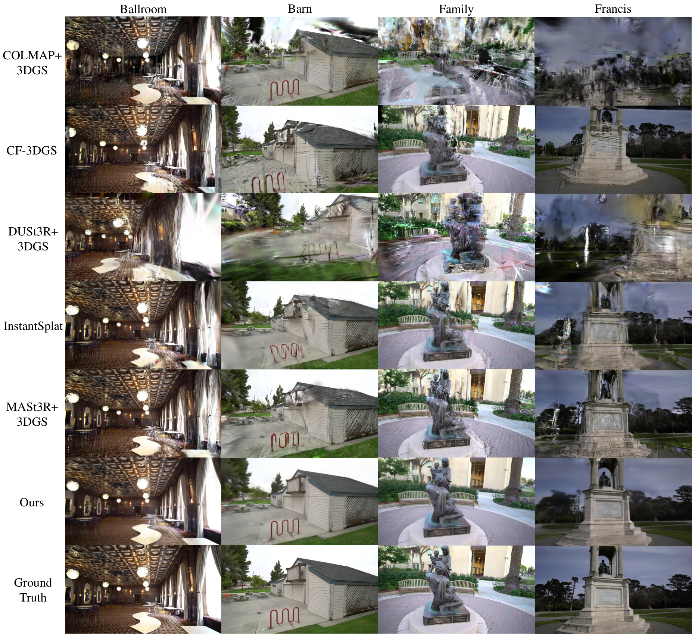
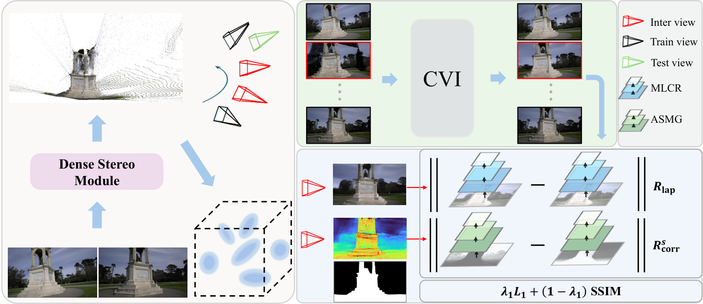

<h1 align="center"><strong>SfM-free 3D Gaussian Splatting</strong></h1>
<h2 align="center">from Extremely Sparse View</h2>

<p align="center">
  <a href="https://wuyou012.github.io/">Zongqi He</a> ·
  Hanmin Li ·
  Kin-Chung Chan ·
  <a href="https://yushenzuo.github.io/">Yushen Zuo</a> ·
  Hao Xie ·
  <a href="http://zachary-zhexiao.github.io/">Zhe Xiao</a> ·
  <a href="https://junxiao01.github.io/">Jun Xiao</a> ·
  Xiaoyang Bai ·
  <a href="https://www.eee.hku.hk/~evanpeng/">Yifan Peng</a> ·
  <a href="https://www.eie.polyu.edu.hk/~enkmlam/">Kin-Man Lam</a>
</p>

<h3 align="center">Computers &amp; Graphics 2026</h3>

<div align="center">
  <a href="https://doi.org/10.1016/j.cag.2026.104684">
    
  </a>
  <a href="https://arxiv.org/abs/2508.15457">
    
  </a>
  <a href="https://scholar.google.com/citations?view_op=view_citation&amp;hl=en&amp;user=74QlqXoAAAAJ&amp;citation_for_view=74QlqXoAAAAJ:WF5omc3nYNoC">
    
  </a>
</div>

<br>

<p align="center">
  
</p>

## Overview

This repository provides the cleaned and reproducible implementation of the paper. It reconstructs a 3D Gaussian scene from only two unposed images by combining dense stereo initialization, coherent view interpolation, and sparse-view Gaussian regularization.

The implementation keeps the validated research behavior unchanged while replacing the original mixed working directories with pinned upstream revisions, tracked source overlays, a unified environment, and reproducible shell entry points.

## Pipeline

<p align="center">
  
</p>

The executable data flow is:

1. **Dense stereo initialization (DSM)** — InstantSplat/MASt3R estimates the endpoint cameras and produces the dense point cloud used to initialize 3DGS.
2. **Coherent view interpolation (CVI)** — ViewCrafter generates 25 camera-controlled frames from the same two selected images; the 23 interior frames become additional supervision.
3. **Sparse-view Gaussian optimization** — ViewGS consumes the MASt3R geometry, the two real views, and the interpolated supervision. The training entry point enables the paper's multi-scale Laplacian and spatial-aware multi-scale geometry losses.

| Paper component | Implementation | Main entry point |
| --- | --- | --- |
| Dense stereo module | InstantSplat + MASt3R | `scripts/run_pipeline.sh` |
| Coherent view interpolation | ViewCrafter + DUSt3R trajectory estimation | `scripts/run_pipeline.sh` |
| MLCR and ASMG optimization | ViewGS overlay and loss functions | `scripts/run_reconstruction.sh` |

## Abstract

Extremely sparse inputs make conventional SfM initialization unreliable and leave too little visual evidence for high-quality 3D Gaussian Splatting. Our framework replaces SfM with dense stereo pose and geometry estimation, then synthesizes coherent intermediate views as additional training supervision. Multi-scale appearance and spatially adaptive geometry regularization further stabilize sparse-view optimization. The resulting system reconstructs detailed, view-consistent scenes from only two training images while retaining real-time 3DGS rendering.

## Installation

The validated server setup uses one Conda environment:

- Python 3.9.16
- PyTorch 1.13.1 with CUDA 11.7 runtime
- PyTorch3D 0.7.5
- CUDA 11.8 toolkit for compiling the ViewGS extensions

```bash
git clone https://github.com/wuyou012/viewgs-repro.git
cd viewgs-repro
cp config.example.env .env
# Set the three checkpoint paths in .env.
bash scripts/setup.sh
```

`setup.sh` clones the exact upstream commits from `sources.lock.env`, applies the tracked overlays, creates the unified environment, compiles the CUDA extensions, and validates all three model entry points. The generated source trees are stored in the ignored `runtime/` directory.

Checkpoint names and verified hashes are listed in [`docs/CHECKPOINTS.md`](docs/CHECKPOINTS.md).

## Data preparation

Each scene uses the following minimal layout. The two directories must contain matching filenames; `images/` is used by MASt3R and `images_full/` supplies full-resolution ViewGS supervision.

```text
scene/
├── images/
│   ├── image_000.jpg
│   └── image_001.jpg
└── images_full/
    ├── image_000.jpg
    └── image_001.jpg
```

The selected pair is read back from MASt3R's generated `images.txt`, ensuring that geometry reconstruction and view interpolation always use the same two images.

## Reproduction

Run the complete two-view pipeline:

```bash
bash scripts/run_pipeline.sh \
  --scene-root /path/to/scene \
  --scene-name Barn \
  --output-root /path/to/output \
  --gpu 0 \
  --iterations 10000
```

Use `--force` to regenerate the MASt3R and ViewCrafter stages. For a wiring-only smoke test, use a new output directory together with `--iterations 5 --ddim-steps 2`.

If the point cloud and interpolated frames already exist, run only the reconstruction stage:

```bash
bash scripts/run_reconstruction.sh \
  --source-path /path/to/scene/sparse_2 \
  --diff-path /path/to/output/diffusion/Barn \
  --model-path /path/to/output/reconstruction/Barn \
  --gpu 0 \
  --iterations 10000
```

Additional training arguments can be appended after `--`.

## Reproducibility status

The clean-clone validation was completed on an NVIDIA RTX 4090 server:

- exact upstream source revisions assembled successfully;
- one fresh unified environment installed successfully;
- MASt3R produced a 293,901-point downsampled initialization;
- ViewCrafter produced 25 frames and ViewGS loaded the expected 23 interior views;
- a five-iteration end-to-end smoke run completed and saved the Gaussian model.

This smoke run verifies installation and data flow, not the paper's final quantitative quality. Full details are recorded in [`docs/VALIDATION.md`](docs/VALIDATION.md), and known behavior-preserving limitations are documented in [`docs/KNOWN_ISSUES.md`](docs/KNOWN_ISSUES.md).

## Repository structure

```text
viewgs-repro/
├── assets/                 # Paper figures used by this README
├── environment/            # Unified Conda and pip specifications
├── overlays/               # Minimal active modifications over pinned sources
├── scripts/                # Setup, full pipeline, and reconstruction entry points
├── docs/                   # Validation, checkpoints, code map, and known issues
├── sources.lock.env        # Exact upstream repository revisions
└── config.example.env      # Machine-specific paths
```

## Acknowledgements

This implementation builds on the following open-source projects:

- [3D Gaussian Splatting](https://github.com/graphdeco-inria/gaussian-splatting)
- [InstantSplat](https://github.com/NVlabs/InstantSplat)
- [MASt3R](https://github.com/naver/mast3r)
- [ViewCrafter](https://github.com/Drexubery/ViewCrafter)
- [DUSt3R](https://github.com/naver/dust3r)
- [FSGS/ViewGS](https://github.com/VITA-Group/FSGS)

Please also follow the licenses and model terms of the upstream repositories and checkpoints.

## Citation

If this code or paper is useful for your research, please cite:

```bibtex
@article{he2026sfmfree,
  title   = {SfM-free 3D Gaussian Splatting from extremely sparse view},
  author  = {He, Zongqi and Li, Hanmin and Chan, Kin-Chung and Zuo, Yushen and Xie, Hao and Xiao, Zhe and Xiao, Jun and Bai, Xiaoyang and Peng, Yifan and Lam, Kin-Man},
  journal = {Computers \& Graphics},
  volume  = {139},
  pages   = {104684},
  year    = {2026},
  doi     = {10.1016/j.cag.2026.104684}
}
```
